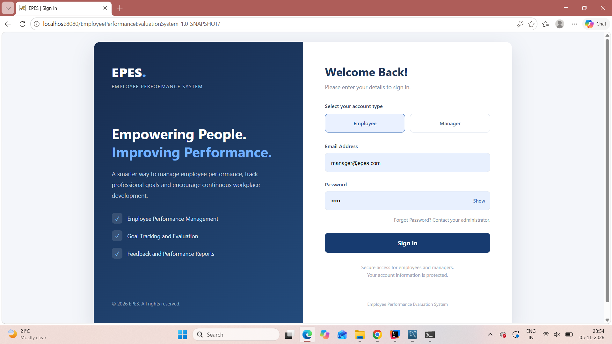
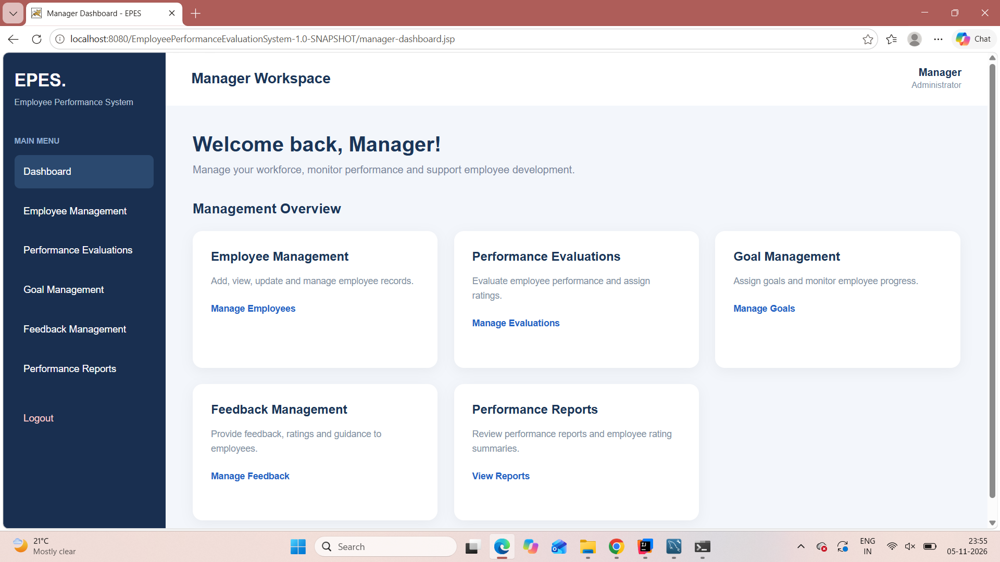
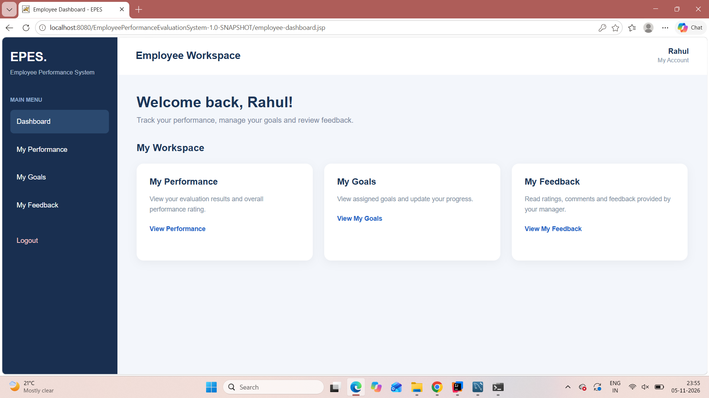
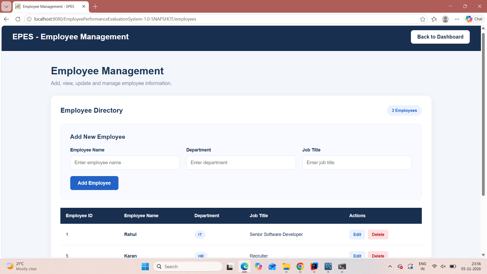
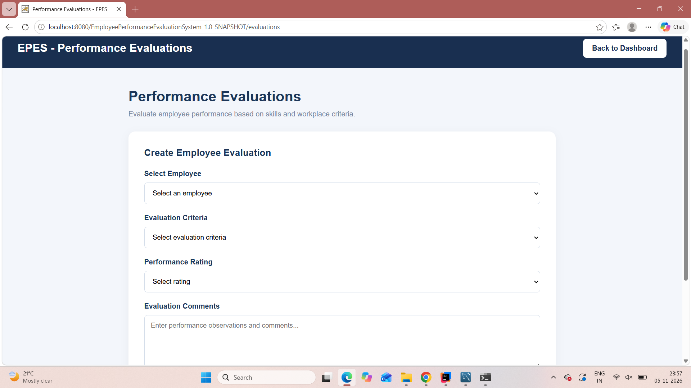
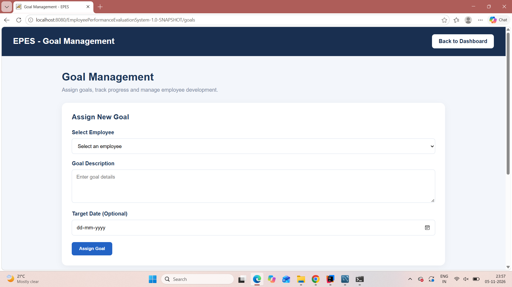
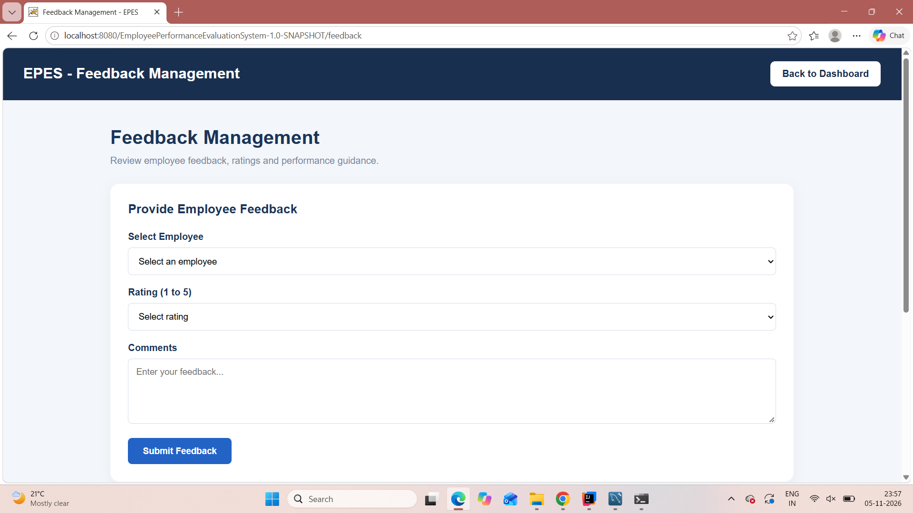
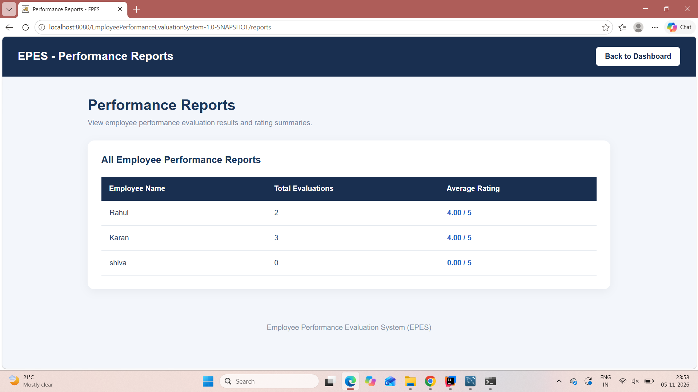

# Employee Performance Evaluation System (EPES)

A Java-based web application for managing employee information and supporting performance evaluations, goal tracking, feedback, and performance summaries. EPES provides separate Manager and Employee experiences with role-based access.

## 1. Project Overview

EPES brings employee records and performance-related activities into one application. Managers can manage employee records, create evaluations, assign goals, provide feedback, and review performance summaries. Employees can sign in to view their own performance information, goals, and feedback.

## 2. Project Objectives

- Centralize employee information and performance records.
- Support manager-led performance evaluations and feedback.
- Assign goals and track employee progress.
- Allow employees to view their own performance information.
- Protect application functions through authentication and role-based authorization.

## 3. Technology Stack

| Technology | Purpose |
|---|---|
| Java 25 | Application logic |
| Jakarta Servlet 6.1 | HTTP request handling |
| JSP, HTML5, CSS3, JavaScript | User interface |
| MySQL 8 | Relational database |
| JDBC / MySQL Connector/J 9.4.0 | Database connectivity |
| Apache Tomcat 11 | Application server |
| Maven | Build and dependency management |
| IntelliJ IDEA | Development environment |

## 4. Main Features

### Manager Features

- Manager sign-in.
- Add, view, update, and delete employee records.
- Create performance evaluations and assign ratings.
- Assign employee goals and manage goal status.
- Provide employee feedback.
- View employee performance summaries and reports.

### Employee Features

- Employee sign-in.
- Personalized employee dashboard.
- View personal performance evaluations and ratings.
- View assigned goals and update goal progress.
- View feedback provided by the manager.

## 5. Application Architecture

The application follows a layered Java web architecture:

1. **Presentation Layer:** JSP pages, HTML, CSS, and JavaScript.
2. **Controller Layer:** Jakarta Servlets handle authentication and application requests.
3. **Security Layer:** Filters enforce authentication, authorization, and CSRF validation.
4. **Data Access Layer:** DAO classes perform database operations using JDBC.
5. **Database Layer:** MySQL stores users, employees, evaluations, goals, feedback, teams, and team membership.

## 6. Database Design

**Database Name:** `epes_db`

The database contains eight tables:

| Table | Purpose |
|---|---|
| `employees` | Employee profile information |
| `users` | Login email, password hash, role, and employee link |
| `evaluations` | Evaluation criteria, ratings, and comments |
| `goals` | Goal descriptions, target dates, and statuses |
| `feedback` | Employee feedback ratings and comments |
| `teams` | Team information |
| `team_members` | Employee-to-team relationships |
| `performance_reports` | Report-related summary structure; report values are currently calculated dynamically |

The database schema uses primary keys, foreign keys, unique constraints, and CHECK constraints.

- Evaluation ratings are restricted to 1–5.
- Feedback ratings are restricted to 1–5.
- Goal status is restricted to `Pending`, `In Progress`, or `Completed`.

**Important:** The `epes_database.sql` file contains the database structure only. It does not include sample employee records or login accounts.

## 7. Security Features

- Passwords are hashed using PBKDF2WithHmacSHA256 with a per-password random salt.
- Manager and Employee roles are checked before protected operations.
- Login creates a fresh authenticated session and rotates the CSRF token.
- State-changing POST forms include a CSRF token validated by a filter.
- Logout is performed through a POST request.
- JDBC operations use `PreparedStatement` parameters.
- Server-side validation checks IDs, ratings, statuses, and required fields.
- Session cookies are configured as HttpOnly, and session tracking is cookie-only.

## 8. Project Structure

```text
EmployeePerformanceEvaluationSystem/
│
├── .mvn/
│   └── wrapper/
│
├── src/
│   └── main/
│       ├── java/com/epe/employeeperformanceevaluationsystem/
│       │   ├── dao/          # Database access classes
│       │   ├── model/        # Application model classes
│       │   ├── servlet/      # Servlets and security filters
│       │   └── util/         # Database, password, CSRF and HTML utilities
│       │
│       └── webapp/
│           ├── WEB-INF/
│           │   ├── web.xml
│           │   └── views/    # Protected JSP views
│           └── *.jsp         # Login, dashboards and application pages
│
├── screenshots/              # Application screenshots
│   ├── login.png
│   ├── manager-dashboard.png
│   ├── employee-dashboard.png
│   ├── employee-management.png
│   ├── evaluations.png
│   ├── goals.png
│   ├── feedback.png
│   └── reports.png
│
├── epes_database.sql
├── mvnw
├── mvnw.cmd
├── pom.xml
└── README.md
```

## 9. System Requirements

- JDK 25
- MySQL Server 8
- MySQL Workbench (recommended)
- Apache Tomcat 11
- Git
- IntelliJ IDEA or another Java IDE

## 10. Installation and Setup

### Step 1: Clone the Repository

```bash
git clone https://github.com/ShivamUpadhyay303/EmployeePerformanceEvaluationSystem.git
cd EmployeePerformanceEvaluationSystem
```

### Step 2: Create and Import the Database

1. Open MySQL Workbench and connect to your MySQL server.
2. Create the database:

```sql
CREATE DATABASE epes_db;
```

3. Select `epes_db` as the default schema.
4. Open `epes_database.sql` from the project root.
5. Execute the SQL script.
6. Refresh the SCHEMAS panel and verify that all eight tables exist.

**Note:** The SQL file contains the database structure only. It does not create sample employee records or login accounts.

### Step 3: Configure the Database Password

The application reads the MySQL password from the `EPES_DB_PASSWORD` environment variable. Do not hardcode the password or commit it to GitHub.

For a temporary PowerShell session, set the variable before starting Tomcat:

```powershell
$env:EPES_DB_PASSWORD = "your_mysql_password"
```

The current database username is configured as `root` in `DBConnection.java`. For production deployment, use a dedicated MySQL application account with only the required permissions.

### Step 4: Create Login Accounts

Use the `UserSetup` utility from the IDE to create the initial Manager account. Create Employee accounts using valid employee IDs. Passwords are hashed before storage.

### Step 5: Build the Application

From the project root, run:

```powershell
.\mvnw.cmd clean package
```

A successful build creates:

```text
target/EmployeePerformanceEvaluationSystem-1.0-SNAPSHOT.war
```

### Step 6: Deploy to Tomcat

1. Stop Tomcat.
2. Copy the generated WAR file into Tomcat's `webapps` directory.
3. Start Tomcat and wait for deployment to finish.

### Step 7: Open the Application

Open the following URL in your browser:

```text
http://localhost:8080/EmployeePerformanceEvaluationSystem-1.0-SNAPSHOT/
```

## 11. Application Screenshots

The following screenshots demonstrate the actual user interface of the Employee Performance Evaluation System.

### 11.1 Login Page



### 11.2 Manager Dashboard



### 11.3 Employee Dashboard



### 11.4 Employee Management



### 11.5 Performance Evaluations



### 11.6 Goal Management



### 11.7 Feedback Management



### 11.8 Performance Reports



## 12. Testing and Code Quality

Functional checks performed during development include:

- Manager and Employee login.
- Employee add, view, update, and delete operations.
- Role-based restrictions on manager-only pages.
- Employee access to employee-specific performance information.
- Logout and protected-page access checks.
- Rating and goal-status validation, including database CHECK constraints.
- CSRF token inclusion in state-changing forms.
- Maven packaging/build checks on the development computer.

The code is separated into model, DAO, servlet, and utility packages. SQL values are passed through prepared statements, and database resources use try-with-resources.

**Testing Note:** The project includes standalone manual test utilities. These should not be described as a complete automated JUnit test suite.

## 13. Team Members and Responsibilities

| Team Member | Role | Responsibilities |
|---|---|---|
| **Shivam Kumar Upadhyay** | **Team Leader – Backend & Integration** | Coordinated project planning and task distribution; worked on Servlets, DAO classes, JDBC/database connectivity, authentication, session management, role-based access, and module integration. |
| **Himanshu Raj Singh** | Frontend & UI Development | Worked on JSP page layouts, HTML/CSS interface design, dashboard presentation, navigation, forms, tables, and user-interface improvements. |
| **Sahil Uttam** | Testing & Documentation | Worked on checking application workflows, testing module behaviour, identifying issues, preparing project documentation and presentation material, and supporting review preparation. |

*The team should confirm that this responsibility division accurately reflects each member's actual contribution before final submission.*

## 14. Future Enhancements

- Password reset and account recovery workflow.
- Optional employee account creation during employee onboarding.
- Email notifications for goals, evaluations, and feedback.
- Downloadable PDF performance reports.
- Department-wise analytics and performance trend visualizations.

## 15. GitHub Repository

**Repository:** [EmployeePerformanceEvaluationSystem](https://github.com/ShivamUpadhyay303/EmployeePerformanceEvaluationSystem)

The repository is public and contains the project source code, database structure, documentation, and application screenshots.

---

**Employee Performance Evaluation System (EPES)**

Galgotias University | B.Tech CSE (AI & ML)

Team: Shivam Kumar Upadhyay • Himanshu Raj Singh • Sahil Uttam